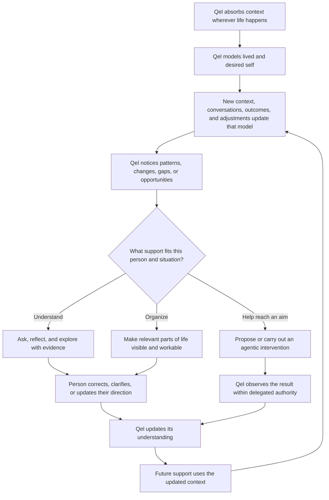

# Qel — Concept

**Status:** Working concept draft  
**Updated:** 2 October 2026  
**Purpose:** Describe Qel's vision, the needs it addresses, its core principles, and the questions still to resolve. The experience sketches and build sequence below are supporting proposals; detailed user flows remain to be designed.

---

## What Qel is

> **Qel is a personal AI that builds a rich understanding of your life and the person you want to become from the context you choose to share. It helps you see what is happening, uncover connections, understand what is or is not on course, organize your life, and proactively help you reach the life you want.**

Qel can be useful across mental wellbeing, ideas and vision alignment, productivity, and personal organization. The context is shared across those parts of life, so an insight in one area can matter in another when there is evidence for that connection.

Qel’s value is helping people make sense of their lives—not simply storing context or getting things done. From what a person chooses to share, Qel helps them understand what is happening, notice connections and changes, and consider how these relate to what matters to them. Conversation is the means; a clear, correctable view of their context can make that understanding easier to inspect and organize. Optional tools can support follow-through when the person decides to act.

That describes an essential part of Qel, not the full destination. Long term, Qel should build an increasingly rich representation of both a person's lived life and the person they want to become. With that context, it can notice meaningful gaps and opportunities, then help bridge them agentically and proactively. This might mean asking, reflecting, organizing, coordinating, or acting through tools and agents; the right capabilities for different people and areas of life are still an open question for us to solve.

Conversation is a central way Qel learns and works with the person. It is also a base for deeper agency: Qel should eventually be able to help between conversations, within a person's chosen and adjustable boundaries, rather than waiting for a new instruction each time.

## The person and the need

People hold different parts of their lives in separate places: memories, plans, work, relationships, ideas, feelings, and commitments. It is difficult to see how those parts relate, whether a situation is changing, or whether day-to-day activity still matches what the person values and intends.

Qel absorbs context from the person's life through effortless ways to send it whatever they encounter, think, or experience. The product takes responsibility for making context available from the moment and place it occurs, understanding it progressively, and relating it to the person's wider life. The person controls what reaches Qel, while Qel handles the work of processing and connecting it. This absorption is a foundation of its personal understanding and eventual agency.

## Context absorption: easy to send, understood progressively

**Qel should absorb easily and understand progressively.** A person should be able to send context when and where they have it: a browser passage, a picture taken while watching a movie, a screenshot, a voice reflection, an epiphany, an idea, a plan, or an update about what actually happened.

Sending context must not require starting a chat, opening a heavy workspace, choosing a category, or explaining its significance. Browser actions, platform sharing, camera and screenshot flows, quick text or voice input, and chosen integrations are potential entry points to design. The exact gestures and supported platforms still need to be worked out.

Qel acknowledges that the material arrived, preserves its original form and available source context, and processes it without interrupting the person's moment. They can add a reaction or intention if they want; an unexplained image or fragment is still valid context. Qel keeps separate what was encountered, what the person said about it, and what Qel thinks it might mean.

Quiet absorption is the default for a simple context drop. Meaning can emerge through later context or conversation. Qel may offer a tentative connection or ask a question when knowing more would be particularly useful, without making every capture an interrogation. An explicit request attached to the material should still get a response.

### Real moments this flow must support

These examples come from our discussion. The proposed responses are experience ideas to refine, not claims about existing functionality.

| Moment | What Qel absorbs | Possible support over time |
|---|---|---|
| **An epiphany occurs** | The realization in the person's own words, with any surrounding context they send. | Connect it to earlier questions or experiences, preserve how their understanding changed, and bring it back when relevant. |
| **An idea appears** | A rough thought, image, voice fragment, or reference, even without a specification. | Let its meaning develop, relate it to other ideas and personal direction, and help explore or specify it when useful. |
| **The person makes a plan** | What they intend, any stated reasons, assumptions, constraints, and timing. | Keep the intended direction available for future support and learn what happened as new context arrives. |
| **The plan goes wrong and needs adjusting** | What changed, what became impractical, the person's reaction, and the revised plan. | Help work out what still matters, what can change, and how to adapt. Preserve the original intention alongside the adjustment instead of treating the person as having failed or overwriting the history. |
| **The person wants to learn something** | Their learning aim, materials, questions, explanations, practice, and updates they send. | Help keep track of where they are, connect new learning to earlier understanding, revisit unresolved questions, and offer useful next steps. Exposure to material alone is not proof of understanding. |
| **The person wants reminders or to keep in touch** | An intention to call someone, check on a friend, return to a topic, or follow through on a commitment. | Offer proactive support that fits the person's intention and circumstances. Let them change timing, defer, dismiss, or update it when life changes. |

Plan changes are especially valuable context. Qel needs to understand the relationship between **what was intended, what actually happened, and how the person adapted**. This should help it support realistic adjustment and learn about changing circumstances, rather than repeatedly reminding the person to follow an obsolete plan.

Qel should also learn **how this person prefers to be helped**. In our discussion, the founder's preference when a plan breaks is to untangle what changed before reworking the plan. Another person, or the same person in an urgent situation, may prefer immediate replanning, space to reflect, or another response. This is a preference to learn through explicit direction, corrections, and feedback over time, rather than a fixed flow for everyone. A current instruction takes precedence over a learned preference; uncertain interpretations remain revisable.

This learning applies across Qel: how much explanation someone wants, when questions help, what kind of initiative they welcome, and how reminders should fit their life. Qel's model of the person includes their preferred ways of receiving support alongside their goals and context. Preferences can depend on the situation and change over time; people should be able to inspect and correct them without repeating their preferences in every conversation.

Learning and relationships also give us concrete candidates for agentic capability discovery: supporting a learning journey and helping someone maintain the relationships they care about. The reminder behavior, initiative, and authority still need to be designed with the person.

## The long-term experience

The long-term loop is **understand the person → compare lived experience with desired direction → notice what may help → learn, organize, or act → observe and update**. Conversation and reflection build understanding; proactive agency helps turn that understanding into progress.

## The role of Active Inference

Active Inference is a conceptual foundation for how Qel can use an evolving model of a person's life to learn and act—not a claim that a particular neuroscience mechanism is already implemented.

In product terms, Qel maintains a revisable model of the context the person has shared: what they say matters, what they are trying to do, what has happened, what they expect, and what remains uncertain. As new context arrives, Qel can compare it with what was expected and notice a possible change, mismatch, or unresolved question.

Qel can respond in two broad ways, often combining them:

- **Learn or reduce uncertainty:** retrieve relevant context, ask a useful question, or help the person examine a possible relationship.
- **Help close a meaningful gap:** notice a possible need or opportunity, clarify the person's direction, organize or coordinate work, or use an enabled agent or tool.

The person's stated and evolving aims govern what “on course” means. Qel should not impose a universal ideal life or mistake uncertainty for failure. Insights remain revisable hypotheses when they go beyond directly shared facts. Proactive intervention is part of the vision; what Qel may do, when it may do it, and within which standing permissions must be shaped around the person and situation.

## First use: start with the person, not a setup project

1. **Explain the relationship.** Qel is a personal AI that can use context the person chooses to share. Explain plainly what information is used, what can be remembered, and how the person can inspect or remove it.
2. **Let the person choose a starting point.** Invite them to talk about what they want Qel to understand or help with now. Examples might include a personal situation, a goal or project, an idea, or getting organized. These are entry points into one Qel, not separate accounts or required product modes.
3. **Let the person talk or send context immediately.** They can describe a situation, ask a question, or send something they encountered and continue their day. Qel should not require a lengthy profile, import, taxonomy, or explanation before accepting context.
4. **Use only available context.** Qel responds to what the person said and any context they have already shared. It makes gaps visible and asks a small number of questions only when the answers could change its understanding or response.
5. **Make its understanding correctable.** When useful, Qel briefly reflects back the people, goals, events, or tensions it thinks are relevant. The person can say “yes,” correct it, or leave the question unresolved.
6. **Offer context sources over time.** The person can add notes, voice, documents, or supported integrations as they choose. Explain what each source contributes before it is connected or imported. Show processing status and make exclusions and removal accessible.
7. **Give the person something to return to.** Preserve the conversation and any explicitly useful context or outcome according to clear memory settings. The person can continue later without repeating everything.

**First-use success:** the person can effortlessly send real context or talk about something that matters. They know it reached Qel, can continue without explaining everything, and can later explore or correct Qel's understanding of it.

## Everyday user flow

### 1. Context reaches Qel wherever life happens

Qel has several entry points: an ongoing conversation, an effortless context drop from another activity, or a chosen integration. A person can ask directly, reflect aloud, send a browser selection or picture, record an epiphany, explain a changed plan, or ask Qel to help them see a broader situation. They should not have to pre-classify it as mental health, work, productivity, or ideation.

Context drops can finish with a brief receipt and let the person continue their activity. Qel processes and relates the material in the background; conversation remains available when the person wants to explore it. Selected sources such as journals, documents, calendars, or tasks can also contribute ongoing context within the access the person chooses.

### 2. Qel assembles relevant context

Qel brings forward information relevant to the current discussion: the person's own statements, goals, relevant events, prior reflections, commitments, and known outcomes. It should not dump the whole archive into the conversation or claim comprehensive knowledge.

When personal history materially informs an answer, Qel makes the basis inspectable. The person can open the relevant conversation, note, or source and say that it no longer applies. Conflicting statements remain visible with dates and context; Qel does not silently pick one as the permanent truth.

### 3. Qel helps the person see what may be happening

Depending on the conversation, Qel can help identify:

- connections between events, relationships, projects, ideas, and decisions;
- recurring patterns or changes over time;
- goals or values the person has stated, and where current activity seems aligned or in tension with them;
- something that appears to be working, going off course, or still unclear;
- assumptions, missing context, or alternative explanations worth considering.

These are invitations to examine a situation, not verdicts about the person. Qel distinguishes direct statements and observed events from its own interpretations. It shows the evidence behind an important insight, expresses uncertainty in ordinary language, and accepts “that does not fit” as useful feedback.

Qel need not end every exchange with advice, a task list, or a motivational prompt. Sometimes the right outcome is a clearer view, a corrected understanding, or no action.

### 4. The person examines and organizes their life

The person can ask Qel to zoom out, connect a current situation to older context, compare recent experience with a stated goal, or help organize what feels tangled. Qel can help build an inspectable “life picture” from the context the person has shared: timelines, goals, relationships, projects, decisions, recurring themes, or other useful structures.

Chat and visual organization serve different needs. Chat helps the person explore and interpret. A life view helps them see the broader picture and make changes to it. The person should be able to correct, rearrange, or dismiss Qel's proposed structure; its internal graph or model need not be exposed as technical machinery.

### 5. Qel supports different areas of life using shared context

Mental wellbeing, ideation and vision alignment, productivity, and organization are applications of the same personal context—not disconnected assistants with incompatible memories.

- **Mental wellbeing:** support reflection and help the person examine their own history and context. Emotional or behavioral interpretations must remain tentative and user-correctable. Diagnosis, treatment guidance, crisis behavior, and clinical claims require a separately defined safety scope before those capabilities are designed or released.
- **Ideas and vision alignment:** help the person develop an idea, compare it with what they say they value or are building toward, identify tensions, and make the idea more concrete when asked.
- **Productivity and organization:** help the person understand commitments and priorities, make sense of what is competing for attention, and organize work around their stated aims.

A person can move between these areas naturally. Qel should connect them when relevant and supported, not force the person into a single life category.

### 6. Qel helps close the gap

Qel should be able to help a person move from understanding toward their desired life. Sometimes this means continuing the conversation or making a situation easier to see. It may also mean noticing something proactively, proposing a specific intervention, coordinating a chain of work, or carrying out a delegated action. Agency is a major part of Qel's long-term value; it is not restricted to responding after the user asks.

The form of support should follow from the person's context and aims. To-dos, alarms, and reminders are examples that may help some people; other users and life areas may need very different interventions. The product must discover these capabilities with users rather than assume a generic agent checklist.

People need to delegate within clear, adjustable boundaries. Qel should show what access and authority a capability needs, make actions traceable to the relevant aim and context, and let people review, limit, or revoke delegation. When an action falls outside the authority the person granted, Qel asks before proceeding. Which actions require per-action approval and which can run under standing permission is an open design question that may differ by user, domain, and consequence.

### 7. Qel updates its understanding and continues later

The person may correct Qel, add an outcome, change a goal, or say that an earlier interpretation no longer applies. They can also send a quick update when plans go wrong and they need to adjust. Qel preserves the earlier intention, what happened, and the revision while updating its current understanding. Growth and changed circumstances should remain visible.

Related reminders, proposed next steps, and delegated work should follow the revised plan within their existing authority. Qel must not keep pushing an outdated commitment after the person has changed direction. If it is unclear whether a plan changed, Qel should treat that as uncertainty rather than silently cancel or reschedule it.

When a later event might relate to an unresolved earlier concern or plan, Qel can surface the possible connection with both sources. The person can confirm it, reject it, or defer it. Similar words alone do not prove that an issue was resolved or that one event caused another.

On return, the person can continue the conversation, ask a new question, inspect their broader life picture, or review work Qel has carried forward. Between sessions, Qel may surface a meaningful change, opportunity, or next step where its context and delegated authority justify it. It explains the connection, makes the basis inspectable, and lets the person tune or dismiss that kind of intervention.

## Trust and recovery paths

| Situation | Required experience |
|---|---|
| Qel has little or no personal context | Say what context is available, give a useful response from it, and invite more only if it would help. |
| Qel misunderstands the person | Accept correction without argument; let the person inspect or remove the mistaken interpretation and its source. |
| Shared context conflicts or changes over time | Show the relevant statements, dates, and circumstances; treat changed views as possible growth, not data corruption. |
| Qel sees a possible pattern | Present it as a hypothesis with supporting examples and plausible alternatives; let the person confirm, reject, or revisit it. |
| Imported information is incomplete or delayed | Show the source and processing state; do not claim that an integration is complete or current when it is not. |
| A context drop cannot be uploaded or processed yet | Preserve it locally where supported, distinguish pending from received, and offer recovery without asking the person to reconstruct or resend it unnecessarily. |
| A delegated action or reminder is wrong | Make it easy to stop, correct, or undo where possible; show what authority Qel used and let the person change it. |
| The person wants privacy or a reset | Provide understandable controls to inspect, pause, exclude, export, and delete context, with clear effects on future answers. |
| The person raises a mental-health crisis or asks for clinical guidance | Follow a separately specified and reviewed safety flow; do not improvise diagnosis or imply clinical capability from general reflection features. |

## Product boundaries

- Qel's understanding can become broad and deep, but it is bounded by the information and permissions the person gives it. “Knows me as well as I know myself” is an aspiration to keep improving, not a claim of perfect knowledge.
- The person's values and goals define their direction. Qel can ask whether they still apply, but must not invent the target.
- A pattern is not a diagnosis; correlation is not causation; an inference is not a remembered fact.
- The person can inspect the evidence and correct Qel's model of them.
- Agentic and proactive support is part of the long-term product. It needs understandable authority, an inspectable basis, feedback, and boundaries matched to consequence.
- Mental-health features need their own safety requirements and review before implementation.
- Plugins, apps, and integrations may extend Qel's capabilities and context. The right capabilities, users, permissions, and interactions remain to be discovered.

## How we discover Qel's agentic capabilities

The open question is not simply which tools Qel should connect to. It is what forms of help meaningfully move different people toward the lives they want, given what Qel can understand about them. We should discover this by working backward from people and outcomes, not by treating a list of generic agent tools as the roadmap.

For each user group and life situation, map:

| Design question | What we need to learn |
|---|---|
| **Who is the person, and what context matters here?** | Their life situation, existing systems, relationships, constraints, and what they want Qel to understand. |
| **Who do they want to become, or what do they want to change?** | Their own desired direction and how they would recognize meaningful progress. |
| **What could Qel notice?** | The events, changes, opportunities, or gaps that are visible in sources the person chose to share. |
| **What kind of help would make a difference?** | Whether the person needs reflection, a question, an insight, organization, preparation, coordination, or an action—and what alternatives they prefer. |
| **What initiative and authority should Qel have?** | When Qel may raise an issue, how proactive it should be, what it can prepare or execute, and where it must check first. |
| **How will the person know it helped?** | The outcome, time horizon, evidence of progress, and how Qel should adapt if the intervention fails or is unwanted. |

One useful dimension to explore with people is a range of agency: **respond when asked → point out an opportunity → prepare a response → act under a standing mandate → manage a bounded outcome and report back**. These are research prompts, not a universal autonomy ladder or fixed settings model. Different capabilities may need different initiative and authority levels, including per-person boundaries.

Each capability should ultimately describe a person and desired outcome, the context Qel needs, what Qel notices, the intervention it can provide, the authority it needs, and how the person corrects or stops it. That gives us a way to explore the many possible forms of agency without prematurely narrowing Qel to reminders, generic productivity actions, or any single user group.

## Full product build sequence

The sequence below turns the full product into buildable stages while preserving the destination.

| Phase | Product outcome | Exit condition |
|---|---|---|
| **0. Define the destination and capability space** | Agree on the life model, how desired self is represented, the role of Active Inference, initial user groups and domains, and how to discover the agentic capabilities each group needs. Map permission and safety boundaries before committing to navigation or architecture. | The team can trace how Qel learns the person, recognizes a relevant gap or opportunity, chooses an intervention, acts within authority, and learns from the result. The open capability choices are explicit. |
| **1. Context absorption and trusted conversation** | Effortless context drops and persistent conversation; private account and context controls; original material, source, reaction, and interpretation kept distinguishable; correction and history. | A person can send real context without organizing or explaining it first, receive an honest capture status, and later use it in a conversation where Qel accepts correction. |
| **2. Evolving life model and life picture** | Represent lived context and desired self; make relevant parts and relationships visible, inspectable, and correctable. | A person can see how Qel understands their context and direction, correct it, and trace important connections to their sources. |
| **3. Context sources and integrations** | Deliberate import and supported connections for the sources that add value to the person's life picture, with permission, status, and removal controls. | The same context model can use selected sources reliably without implying access to anything the person did not share. |
| **4. Insight and Active Inference** | Identify meaningful changes, uncertainty, tensions, and opportunities; choose when to learn, ask, reflect, or initiate support. | Insights are grounded in evidence, useful to the person, calibrated as hypotheses, and improved by feedback. |
| **5. User-specific agentic capabilities** | Discover and build capabilities for selected people and life areas—from simple follow-through to more complex agentic help—based on demonstrated needs. | Each capability has a clear user and desired outcome, uses relevant life context, and has defined permission and recovery behavior. |
| **6. Proactive, delegated support** | Let Qel notice and act between conversations within authority the person has chosen, then observe outcomes and update its model. | Delegated actions are traceable to the person's aims, reliable, adjustable or revocable, and demonstrably help close a meaningful gap. |
| **7. Broader capability ecosystem and reliability** | Expand across users, domains, apps, plugins, and integrations; mature privacy, safety, accessibility, recovery, and performance. | The product remains understandable, trustworthy, and useful across diverse lives and levels of delegated agency. |

## Decisions for the next design pass

These are the choices that most affect the actual user flow. My starting recommendations are included for discussion:

1. **Entry points:** Design effortless absorption from the moments context appears alongside conversation and proactive support. Work through browser passages, movie pictures, epiphanies, ideas, plans, and adjustments before choosing the specific capture gestures.
2. **Life overview:** Pair chat with a visual, editable view of a person's context. Decide which things they should see and organize there before choosing canvas, timeline, graph, or other UI patterns.
3. **Context growth:** Make absorption simple wherever context arises. Quietly preserve unexplained material and let meaning emerge over time; ask or offer an interpretation when doing so adds value. Decide how conversation, everyday drops, archives, and chosen integrations contribute together.
4. **Active Inference in product behavior:** Define concrete behaviors—what Qel notices, when it learns, when it asks, when it initiates support or acts, and how the person corrects its model—before choosing numeric thresholds or claiming a faithful simulation.
5. **Mental-health scope:** Decide whether this is personal reflection, a clinically oriented product, or both, then specify the corresponding safeguards with appropriate expertise before building that area.
6. **Proactive support:** Discover what should trigger Qel to notice, reach out, or act for different users. Make each kind of initiative understandable and adjustable to its value and interruption cost.
7. **First release audience:** Use the real person and life context you want Qel to understand as the design case. Keep the architecture broad enough to support the other stated applications without designing a vague “for everyone” flow.

## Relationship to existing project documents

This draft corrects both the capture-to-action framing and the conversation-only destination. The project also contains a conversation-first agent concept, a visual knowledge stream, an ambitious Cognitive Event Graph, a podcast-to-outreach example, and early agentic features. They should be reconciled against this long-term vision before updating the feature specs, technical architecture, or implementation roadmap. The draft is not yet a claim that any of those capabilities exist in the code.
